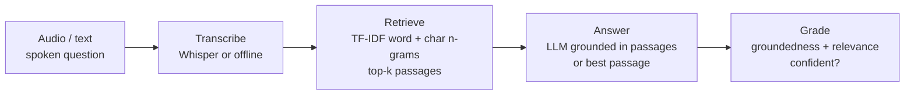

# VoiceQA

A spoken-question answering pipeline that does not just answer — it checks its
own work. A question (as audio or text) is transcribed, grounded in a knowledge
base by retrieval, answered by an LLM using only the retrieved context, and then
**graded** for how well the answer is supported. A low-confidence answer is
flagged for a human instead of being served.

Every stage is provider-agnostic and has an offline fallback, so the pipeline
runs end to end with no API keys and no network — and upgrades to real speech and
LLM providers by setting a few environment variables.

[](.github/workflows/ci.yml)
[](pyproject.toml)
[](LICENSE)

---

## Why it matters

Voice assistants and support bots fail in a specific, damaging way: they answer
confidently when they should not. The fix is not a bigger model; it is a
pipeline that **grounds** answers in a known source and **grades** them before
they reach a caller. VoiceQA makes both explicit:

- **Grounded.** Answers are built only from retrieved knowledge-base passages,
  and the passages used are cited.
- **Graded.** An LLM (or an offline heuristic) scores each answer for
  groundedness and relevance; anything below a threshold is routed to a human.
- **Resilient.** Transcription and the LLM are pluggable, and each has a fallback,
  so a missing key or a provider outage degrades gracefully instead of failing.

## How it works



1. **Transcribe (`transcribe.py`).** A `Transcriber` turns audio into text.
   `WhisperTranscriber` calls an OpenAI-compatible endpoint; `ProvidedTranscript`
   treats its input as already-recognised text (used offline and in tests).
2. **Retrieve (`knowledge.py`).** A TF-IDF + cosine-similarity search returns the
   top-k most relevant knowledge-base passages. The vectoriser unions a word view
   (1–2 grams) with a character view (`char_wb` 3–5 grams), so a reworded spoken
   question ("refunds" vs "refund") still retrieves the right topic.
3. **Answer (`answerer.py`).** The LLM answers using only those passages. If the
   LLM is unreachable, the best-matching passage is returned verbatim.
4. **Grade (`grader.py`).** The LLM (or a token-overlap heuristic) scores the
   answer's groundedness and relevance; the pipeline marks it confident or
   recommends escalation.

## How grounding and grading are computed

**Answering is grounded** by construction: the answerer's prompt passes only the
retrieved passages and instructs the model to answer from them alone or say *"I
don't have that information."* The passages used are returned as citations. If
the LLM is unreachable, the fallback returns the single top passage verbatim —
still grounded and traceable.

**Grading** produces two independent signals (from the LLM as JSON, or from a
heuristic when offline):

```
groundedness = |content_words(answer) ∩ content_words(context)| / |content_words(answer)|
coverage     = |content_words(question) ∩ content_words(context)| / |content_words(question)|
top_score    = max cosine similarity of the retrieved passages to the question
relevant     = coverage ≥ 0.15  OR  top_score ≥ 0.30
confident    = groundedness ≥ VQ_MIN_GROUNDEDNESS  AND  relevant
```

The two signals catch different failures, which is why both are needed. A
fallback answer (a verbatim passage) is always highly *grounded* — so groundedness
alone would wave through an off-topic answer. **Relevance** is what catches it,
and it reads two complementary signals, accepting the answer when *either* is
clearly met: how much of the *question* the retrieved context covers, and how
confidently retrieval matched the question in the first place. When the pipeline
retrieves the nearest passage for an out-of-scope question like *"what is the
capital of France?"*, the answer is grounded (≈1.0) but coverage is near zero
*and* the best retrieval score is low, so `confident` is false and the request is
escalated.

The offline relevance rule is deliberately conservative. Coverage requires a real
overlap, not one shared word, so a single common term ("month") cannot pass a
billing-cycle answer off as relevant to a plan-change question. The retrieval
score lets a confident match through even when the surface words differ, while a
heavily reworded question that shares little with the corpus ("end my agreement
early" for *cancel contract*) stays below both thresholds and is escalated rather
than answered with false confidence. A false escalation costs a human glance; a
false "confident" ships a wrong answer. The reliable relevance judgement is the
LLM grader — this is its lexical fallback, and escalation is a first-class
outcome.

## Validating the grader on real data

A grader is only worth trusting if its score actually tracks whether an answer is
right. VoiceQA's grader is measured against ground truth on **real spoken-QA
data** — [Spoken-SQuAD](https://huggingface.co/datasets/alinet/spoken_squad),
SQuAD 1.1 passages synthesised to speech and transcribed back with ASR, so every
passage carries genuine recognition noise. The benchmark reuses the production
`Grader` end to end (offline, so the token-overlap path runs) and asks a single
question: **does the groundedness score separate correct from incorrect
answers?**

Each question is paired with its own gold answer (correct) and with a foreign
gold answer from another item (incorrect), both graded against the same
transcribed passage. The headline metric is **ROC-AUC** of the groundedness
score — threshold-free, and equal to the probability that a correct answer scores
above an incorrect one (0.5 is chance, 1.0 is perfect).

```bash
python -m voiceqa.real_benchmark --config default   # lower-noise ASR (~22% WER)
python -m voiceqa.real_benchmark --config wer44      # stress ASR (~44% WER)
```

| Metric (~760 labeled triples) | `default` (~22% WER) | `wer44` (~44% WER) |
| --- | --- | --- |
| **ROC-AUC** (held-out) | **0.987** (0.994) | **0.849** (0.841) |
| mean score, correct vs wrong | 0.986 vs 0.062 | 0.712 vs 0.098 |
| gate accuracy / precision / recall | 0.934 / 0.925 / 0.945 | 0.798 / 0.875 / 0.697 |
| Spearman ρ (score vs token-F1) | 0.946 | 0.672 |
| **control — shuffled labels** | 0.505 | 0.502 |
| **control — random reference passage** | 0.505 | 0.497 |

The two **negative controls** are what make the result credible rather than a
lucky number. Shuffling the labels, or grading each answer against a random
unrelated passage, both drive the AUC to ~0.50: the score keeps its
discriminating power *only* when the labels and the passages are the real ones.
A score that survives both controls is measuring something real.

**Reading the result — when the lexical grader is enough, and when it is not.**
On lower-noise transcripts the token-overlap grounding check is strong (AUC
0.99). As ASR error rises it degrades predictably to 0.85: the recall drop shows
why — when speech-to-text mangles the answer's own words (a date read aloud, a
rare name), the correct answer is no longer lexically present in the transcript,
so the grader cannot confirm it and conservatively escalates. That is the
boundary. The lexical grader is a fast, dependency-free gate that is more than
adequate for clean transcripts and high-recall triage; for heavily-degraded
audio or answers that are semantically but not lexically present, wire in the LLM
grader path (already in `grader.py`) and re-run this same benchmark to quantify
the gain. The measurement is the capability: it tells you exactly where the cheap
grader stops being enough.

See [`datasets/README.md`](datasets/README.md) for the data, license, and how the
triples are built, and [`docs/estudio/`](docs/estudio/) for a full walkthrough of
the ROC-AUC definition and the controls.

## Quick start

```bash
python -m venv .venv && source .venv/bin/activate
pip install -e ".[dev]"

# Answer a few sample questions (works offline, no API key needed):
python -m voiceqa.cli demo

# Ask one question:
python -m voiceqa.cli ask "what happens if I pay late?"

# Run the HTTP API:
uvicorn voiceqa.main:app --reload
```

Example API calls:

```bash
curl -s -X POST localhost:8000/ask -H 'content-type: application/json' \
  -d '{"question": "how do I replace a lost SIM?"}'

# /ask/voice takes a transcript standing in for uploaded audio
curl -s -X POST localhost:8000/ask/voice -H 'content-type: application/json' \
  -d '{"transcript": "when is my bill issued?"}'
```

## Using real speech and LLM providers

The pipeline is provider-agnostic:

- **Speech-to-text:** set `OPENAI_API_KEY` and wire in `WhisperTranscriber` to
  transcribe real audio files.
- **LLM:** set any of `ANTHROPIC_API_KEY`, `OPENAI_API_KEY`, `GEMINI_API_KEY`,
  `DEEPSEEK_API_KEY` (or run a local Ollama). The cascade tries providers in the
  order given by `VQ_LLM_SPEC` and skips any without a key.

With nothing set, retrieval answers the question and a heuristic grades it.

## Configuration

Settings load from environment variables with the `VQ_` prefix (see
`.env.example`):

| Variable             | Default                                   | Meaning                                |
| -------------------- | ----------------------------------------- | -------------------------------------- |
| `VQ_TOP_K`           | `3`                                       | Passages retrieved to ground an answer |
| `VQ_MIN_GROUNDEDNESS`| `0.5`                                     | Below this, an answer is escalated     |
| `VQ_LLM_SPEC`        | `anthropic,openai,gemini,deepseek,ollama` | Provider cascade, tried in order       |
| `VQ_LLM_MAX_TOKENS`  | `400`                                     | Max tokens per LLM call                |
| `VQ_ASR_MODEL`       | `whisper-1`                               | Speech-to-text model                   |

API keys live in their own environment variables and are never hard-coded.

## Testing

```bash
ruff check voiceqa tests
pytest --cov=voiceqa --cov-report=term-missing --cov-fail-under=80
```

The suite covers transcription (offline and the no-key guard), retrieval, the
answerer (LLM and fallback paths), the grader (heuristic, LLM JSON, and clamping),
the full pipeline (in-scope confident vs. out-of-scope escalation), the HTTP API,
and the CLI. It also covers the real-data validation: the Spoken-SQuAD loader and
label derivation, the networked fetch's retry-then-succeed and
retry-exhausted paths (monkeypatched offline), the ROC-AUC/precision/recall
implementations (including agreement with scikit-learn and the
perfectly-separable → 1.0 / inverted → 0.0 edge cases), and that the grader
discriminates above chance while both negative controls collapse. Nothing in the
tests touches a real network.

Run the grader validation itself with `make benchmark` (or
`python -m voiceqa.real_benchmark`).

## Documentation

- `docs/architecture.md` — the full picture and the data flow.
- `docs/adr/` — the main design decisions and why they were made.
- `docs/estudio/` — a study guide in Spanish, for learning the project in depth.

## License

[MIT](LICENSE) © Angelo David Padilla Romero
