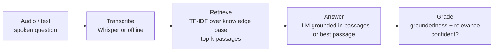

# VoiceQA

A spoken-question answering pipeline that does not just answer — it checks its
own work. A question (as audio or text) is transcribed, grounded in a knowledge
base by retrieval, answered by an LLM using only the retrieved context, and then
**graded** for how well the answer is supported. A low-confidence answer is
flagged for a human instead of being served.

Every stage is provider-agnostic and has an offline fallback, so the pipeline
runs end to end with no API keys and no network — and upgrades to real speech and
LLM providers by setting a few environment variables.

[](.github/workflows/ci.yml)
[](pyproject.toml)
[](LICENSE)

---

## Why it matters

Voice assistants and support bots fail in a specific, damaging way: they answer
confidently when they should not. The fix is not a bigger model; it is a
pipeline that **grounds** answers in a known source and **grades** them before
they reach a caller. VoiceQA makes both explicit:

- **Grounded.** Answers are built only from retrieved knowledge-base passages,
  and the passages used are cited.
- **Graded.** An LLM (or an offline heuristic) scores each answer for
  groundedness and relevance; anything below a threshold is routed to a human.
- **Resilient.** Transcription and the LLM are pluggable, and each has a fallback,
  so a missing key or a provider outage degrades gracefully instead of failing.

## How it works



1. **Transcribe (`transcribe.py`).** A `Transcriber` turns audio into text.
   `WhisperTranscriber` calls an OpenAI-compatible endpoint; `ProvidedTranscript`
   treats its input as already-recognised text (used offline and in tests).
2. **Retrieve (`knowledge.py`).** A TF-IDF + cosine-similarity search returns the
   top-k most relevant knowledge-base passages.
3. **Answer (`answerer.py`).** The LLM answers using only those passages. If the
   LLM is unreachable, the best-matching passage is returned verbatim.
4. **Grade (`grader.py`).** The LLM (or a token-overlap heuristic) scores the
   answer's groundedness and relevance; the pipeline marks it confident or
   recommends escalation.

## How grounding and grading are computed

**Answering is grounded** by construction: the answerer's prompt passes only the
retrieved passages and instructs the model to answer from them alone or say *"I
don't have that information."* The passages used are returned as citations. If
the LLM is unreachable, the fallback returns the single top passage verbatim —
still grounded and traceable.

**Grading** produces two independent signals (from the LLM as JSON, or from a
heuristic when offline):

```
groundedness = |content_words(answer) ∩ content_words(context)| / |content_words(answer)|
relevant     = |content_words(question) ∩ content_words(context)| / |content_words(question)| ≥ 0.15
confident    = groundedness ≥ VQ_MIN_GROUNDEDNESS  AND  relevant
```

The two signals catch different failures, which is why both are needed. A
fallback answer (a verbatim passage) is always highly *grounded* — so grounded­ness
alone would wave through an off-topic answer. **Relevance** is what catches it:
it measures how much of the *question* the retrieved context actually covers.
When the pipeline retrieves the nearest passage for an out-of-scope question like
*"what is the capital of France?"*, the answer is grounded (≈1.0) but the context
covers none of the question, so `confident` is false and the request is escalated.

The offline relevance rule is deliberately conservative. Measuring the
question against the answer alone (an earlier version) was too permissive: one
shared word — "month" — let a billing-cycle answer pass as relevant to a
plan-change question, a confident wrong answer. Measuring coverage of the
question by the retrieved context fixes that, and where a heavily reworded
question ("end my agreement early" for *cancel contract*) shares little
vocabulary with the corpus, the offline grader errs toward escalation rather
than a confident guess. A false escalation costs a human glance; a false
"confident" ships a wrong answer. The reliable relevance judgement is the LLM
grader — this is its lexical fallback, and escalation is a first-class outcome.

## Quick start

```bash
python -m venv .venv && source .venv/bin/activate
pip install -e ".[dev]"

# Answer a few sample questions (works offline, no API key needed):
python -m voiceqa.cli demo

# Ask one question:
python -m voiceqa.cli ask "what happens if I pay late?"

# Run the HTTP API:
uvicorn voiceqa.main:app --reload
```

Example API calls:

```bash
curl -s -X POST localhost:8000/ask -H 'content-type: application/json' \
  -d '{"question": "how do I replace a lost SIM?"}'

# /ask/voice takes a transcript standing in for uploaded audio
curl -s -X POST localhost:8000/ask/voice -H 'content-type: application/json' \
  -d '{"transcript": "when is my bill issued?"}'
```

## Using real speech and LLM providers

The pipeline is provider-agnostic:

- **Speech-to-text:** set `OPENAI_API_KEY` and wire in `WhisperTranscriber` to
  transcribe real audio files.
- **LLM:** set any of `ANTHROPIC_API_KEY`, `OPENAI_API_KEY`, `GEMINI_API_KEY`,
  `DEEPSEEK_API_KEY` (or run a local Ollama). The cascade tries providers in the
  order given by `VQ_LLM_SPEC` and skips any without a key.

With nothing set, retrieval answers the question and a heuristic grades it.

## Configuration

Settings load from environment variables with the `VQ_` prefix (see
`.env.example`):

| Variable             | Default                                   | Meaning                                |
| -------------------- | ----------------------------------------- | -------------------------------------- |
| `VQ_TOP_K`           | `3`                                       | Passages retrieved to ground an answer |
| `VQ_MIN_GROUNDEDNESS`| `0.5`                                     | Below this, an answer is escalated     |
| `VQ_LLM_SPEC`        | `anthropic,openai,gemini,deepseek,ollama` | Provider cascade, tried in order       |
| `VQ_LLM_MAX_TOKENS`  | `400`                                     | Max tokens per LLM call                |
| `VQ_ASR_MODEL`       | `whisper-1`                               | Speech-to-text model                   |

API keys live in their own environment variables and are never hard-coded.

## Testing

```bash
ruff check voiceqa tests
pytest --cov=voiceqa --cov-report=term-missing --cov-fail-under=80
```

The suite covers transcription (offline and the no-key guard), retrieval, the
answerer (LLM and fallback paths), the grader (heuristic, LLM JSON, and clamping),
the full pipeline (in-scope confident vs. out-of-scope escalation), the HTTP API,
and the CLI. Nothing in the tests touches a real network.

## Documentation

- `docs/architecture.md` — the full picture and the data flow.
- `docs/adr/` — the main design decisions and why they were made.
- `docs/estudio/` — a study guide in Spanish, for learning the project in depth.

## License

[MIT](LICENSE) © Angelo David Padilla Romero
