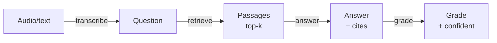

# Architecture

VoiceQA answers a spoken question by transcribing it, grounding it in a knowledge
base, answering with an LLM, and grading the answer before it is served. This
document describes the pieces, the data flow, and the boundaries between them.

## The pieces

| Layer          | Module                    | Responsibility                                          |
| -------------- | ------------------------- | ------------------------------------------------------- |
| Transcription  | `voiceqa/transcribe.py`   | Audio → text, behind a `Transcriber` protocol           |
| Knowledge      | `voiceqa/knowledge.py`    | TF-IDF (word + char n-gram) retrieval over a FAQ        |
| Answering      | `voiceqa/answerer.py`     | LLM answer grounded in retrieved passages (+ fallback)  |
| Grading        | `voiceqa/grader.py`       | Score groundedness + relevance (LLM or heuristic)       |
| LLM interface  | `voiceqa/llm/`            | Provider-agnostic client with a fallback cascade        |
| Orchestration  | `voiceqa/service.py`      | The transcribe → retrieve → answer → grade pipeline     |
| HTTP API       | `voiceqa/main.py`         | Expose the pipeline over REST                           |
| CLI            | `voiceqa/cli.py`          | Demo and single-question ask                            |

## Data flow

## The central idea: ground, then grade

A voice assistant's worst failure is a confident wrong answer. VoiceQA is built
so that cannot happen silently:

- **Ground.** The answerer may use *only* the retrieved passages. It is told to
  say "I don't have that information" when the context does not cover the
  question. The passages used are returned as citations.
- **Grade.** A separate step scores the answer's **groundedness** (is it
  supported by the context?) and **relevance** (does it address the question?).
  An answer that is not both grounded and relevant is marked low-confidence and
  the pipeline recommends escalation to a human.

Grounding and grading are separate steps on purpose: the component that answers
is not the component that judges the answer, so a confident-sounding answer still
has to pass an independent check.

## Every stage is pluggable, with a fallback

- **Transcription** is a `Transcriber` protocol. `WhisperTranscriber` calls a
  real speech API; `ProvidedTranscript` treats its input as already-recognised
  text. The pipeline does not care which is behind it.
- **The LLM** is the provider-agnostic `LLMClient` with a cascade over Anthropic,
  OpenAI, Gemini, DeepSeek, and Ollama. When all providers fail, the answerer
  falls back to the best retrieved passage and the grader falls back to a
  token-overlap heuristic.

The result: the pipeline runs end to end offline with no keys, and upgrades to
real providers purely through configuration.

## Retrieval

`KnowledgeBase` builds a TF-IDF matrix over the FAQ (question + answer text) once,
and `retrieve` returns the top-k passages by cosine similarity, each with its
score. The vectoriser is a `FeatureUnion` of a **word** view (1–2 grams, for
distinctive terms and phrases) and a **character** view (`char_wb` 3–5 grams, for
matching inside words). The character view is deliberate: questions arrive by
voice and are reworded, so "refund"/"refunds" or "cancel"/"cancellation" must
still align — a word-only model treats them as unrelated tokens. TF-IDF remains
simple, explainable, fast, and needs no model to train or host. Grounding answers
in these retrieved passages is what makes the grading step meaningful — there is a
concrete source to check the answer against.

## Grading detail

The grader prefers the LLM, which returns a strict JSON object
(`groundedness`, `relevant`, `rationale`) that is parsed and clamped to a valid
range. If the LLM is unavailable or its answer is unparseable, the heuristic
estimates **groundedness** as the fraction of the answer's content words found in
the retrieved context, and judges **relevance** from two complementary signals,
accepting the answer when *either* is clearly met and escalating when both are
weak:

1. **lexical coverage** — the fraction of the question's content words the
   retrieved context covers (one shared word is not enough; a real overlap is);
   and
2. **retrieval confidence** — the best passage's cosine similarity to the
   question, which accepts a confident retrieval even when the surface words
   differ.

The bias is deliberate: a false escalation (a human looks at a good answer) is
cheap; a false "confident" (a wrong answer shipped as correct) is not.
`confident = groundedness >= threshold and relevant`.

## Extension points

- **Knowledge base.** `FAQ` is plain data; swap in a domain corpus or a real
  document store behind the same `retrieve` interface.
- **Transcriber.** Any engine implementing `Transcriber` (a local model, another
  cloud ASR) drops in without touching the pipeline.
- **Providers.** A new LLM provider is one adapter plus one registry line.
- **Grading policy.** The confidence rule and threshold live in one place and can
  be tuned per deployment.
