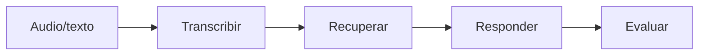

# 01 — El pipeline y el "grounding"

## El problema que resolvemos

El peor fallo de un asistente de voz o un bot de soporte es una **respuesta
equivocada dicha con seguridad**: responde con fluidez a algo que no tiene base
para responder, y la persona se fía. Un modelo más grande reduce esto, pero no lo
elimina, y no te dice **cuándo** dudar de una respuesta.

VoiceQA está diseñado para que eso no pase en silencio. La idea central tiene dos
partes: **fundamentar** (grounding) y luego **evaluar** (grading).

## Las cuatro etapas

1. **Transcribir:** el audio se convierte en texto (etapa enchufable).
2. **Recuperar:** se buscan en la base de conocimiento los pasajes más relevantes
   (TF-IDF).
3. **Responder:** el LLM responde usando **solo** esos pasajes.
4. **Evaluar:** se puntúa la respuesta (¿está fundamentada? ¿es relevante?) y se
   decide si es fiable o se deriva a un humano.

## Fundamentar (grounding)

"Fundamentar" significa que la respuesta se construye **solo** con los pasajes
recuperados. Al LLM se le dice: "responde usando únicamente el contexto; si la
respuesta no está en el contexto, di exactamente 'I don't have that
information'". Y se devuelven los pasajes usados como **citas**.

¿Por qué? Porque así la respuesta tiene una **fuente concreta** que luego se puede
verificar. Sin fundamentar, el modelo inventaría desde su conocimiento general y
no habría nada contra qué comprobar.

## Evaluar (grading)

Después de responder, una etapa **separada** puntúa:

- **Groundedness (fundamentación):** ¿la respuesta está respaldada por el
  contexto?
- **Relevancia:** ¿responde de verdad a la pregunta?

Si no es ambas cosas, se marca como baja confianza y el pipeline recomienda
**derivar a un humano**.

Clave de diseño: **quien responde no es quien juzga**. El componente que escribe
la respuesta y el que la evalúa están separados, así que una respuesta que "suena
segura" todavía tiene que pasar una comprobación independiente.

## La derivación como resultado de primera clase

"No estoy seguro, que lo vea una persona" no es un fallo: es un **resultado
válido** del sistema (`escalate = True`). Convertir la duda en una derivación es
mejor que convertirla en un "sí" silencioso (filtra información mala) o un "no"
silencioso (bloquea ayuda legítima).

## Para fijar la idea

- Problema: respuestas equivocadas dichas con seguridad.
- Solución: fundamentar (responder solo con pasajes recuperados) y evaluar
  (puntuar antes de servir).
- Quien responde ≠ quien evalúa.
- La derivación a un humano es un resultado explícito, no un error.
