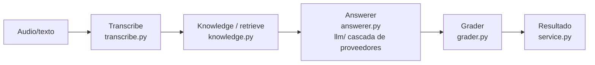

# 04 — Arquitectura y decisiones de diseño

## Las piezas, de principio a fin

Por encima: la **API HTTP** (`main.py`, FastAPI) y la **CLI** (`cli.py`, demo y
pregunta suelta).

## Flujo (service.py)

1. `transcriber.transcribe(audio)` → texto (o texto directo).
2. `knowledge.retrieve(pregunta, k)` → `top_k` pasajes.
3. `answerer.answer(pregunta, pasajes)` → respuesta fundamentada (+ citas).
4. `grader.grade(pregunta, respuesta, pasajes)` → fundamentación, relevancia,
   confianza.
5. Se devuelve un dict con todo, incluido `escalate` (= no confiable).

## Decisión 1: fundamentar y luego evaluar

Explicada en la guía 01. Es la idea central: responder solo con lo recuperado y
comprobar la respuesta antes de servirla, con quien responde separado de quien
evalúa. Evita respuestas equivocadas dichas con seguridad.

## Decisión 2: transcripción enchufable

Explicada en la guía 02. Una interfaz `Transcriber` con un motor real (Whisper) y
uno offline (`ProvidedTranscript`). Probable sin red e independiente del motor.

## Decisión 3: recuperación TF-IDF (palabra + carácter)

Explicada en la guía 02. Simple, explicable, determinista y sin infraestructura,
adecuada para una base pequeña y distintiva. El vectorizador une una vista de
palabra (1–2 gramas) con una de carácter (`char_wb` 3–5 gramas), de modo que una
pregunta hablada reformulada ("refunds" por "refund") recupera igual el tema
correcto. La interfaz permite cambiar a embeddings densos después.

## Decisión 4: degradación elegante en cada etapa

Explicada en la guía 03. Cada etapa con dependencia externa tiene un respaldo:
transcripción (texto provisto), respuesta (mejor pasaje), evaluación (heurística
de solapamiento). El pipeline **siempre** devuelve algo útil y trazable, y marca
con qué camino (`*_source`) se obtuvo. Corre sin claves ni red (así corre CI y la
demo).

## El LLM agnóstico del proveedor

Igual que en otros proyectos: una interfaz `LLMClient` y una `CascadeLLM` que
prueba Anthropic, OpenAI, Gemini, DeepSeek y Ollama en orden, cayendo al
siguiente si uno falla. Libertad (config) y resiliencia (nadie es único punto de
fallo). Claves solo del entorno.

## Configuración por entorno

`config.py` con prefijo `VQ_`: `VQ_TOP_K` (pasajes a recuperar),
`VQ_MIN_GROUNDEDNESS` (umbral para derivar), `VQ_LLM_SPEC` (orden de proveedores),
`VQ_LLM_MAX_TOKENS`, `VQ_ASR_MODEL`. Nada sensible en el código.

## Puntos de extensión

- **Base de conocimiento:** cambiar `FAQ` por un corpus del dominio o un almacén
  real tras la misma interfaz `retrieve`.
- **Transcriptor:** cualquier motor que implemente `Transcriber`.
- **Proveedores LLM:** un adaptador nuevo + una línea en el registro.
- **Política de confianza:** la regla y el umbral viven en un solo sitio.

## Para fijar la idea

- Cuatro etapas, cada una tras una interfaz, cada una con respaldo.
- Fundamentar + evaluar es el corazón; el LLM agnóstico y la degradación elegante
  lo sostienen.
- Todo configurable por entorno; todo ejecutable sin red.
